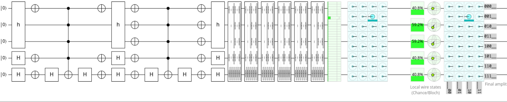
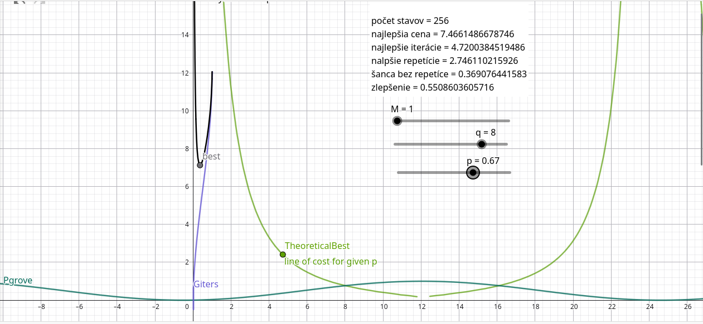
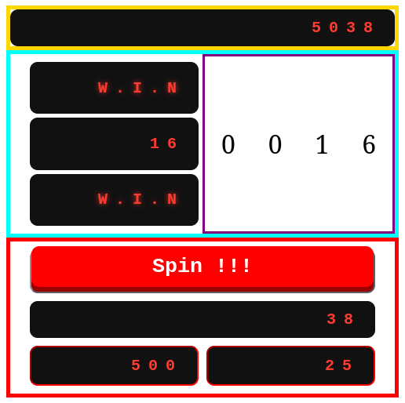
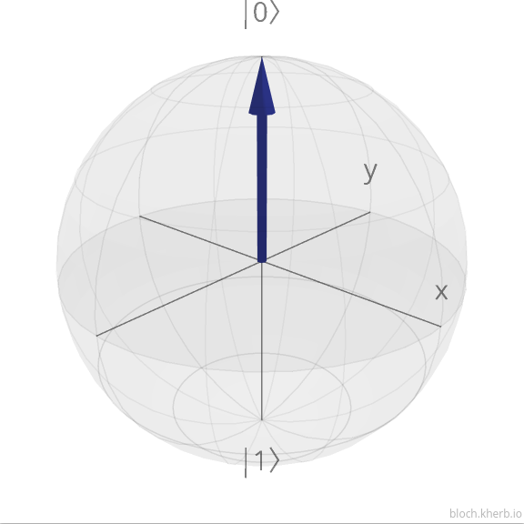
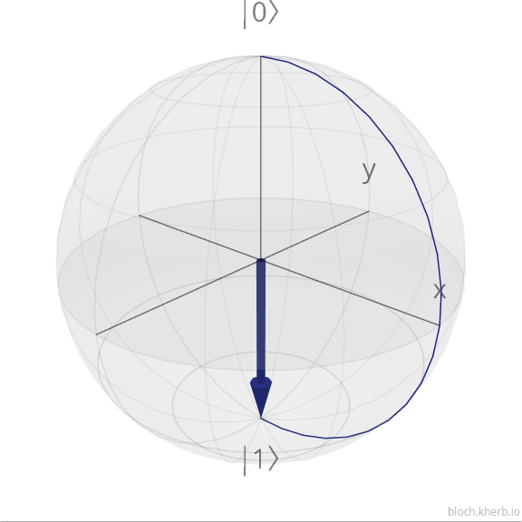
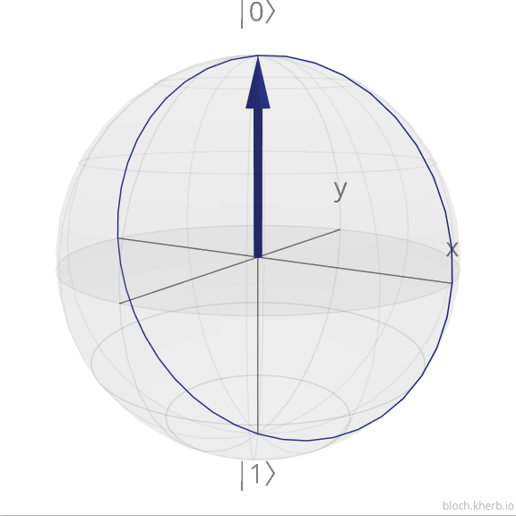

# Quantum Casino

> The world's first casino where the house edge is quantum mechanics.

**Authors:** Martin Breznican, Vladimir Necasny, Oliver Graus, Gabriel Hospodarik

## Summary
- Idea: while absorbing preliminary lessons before hackathon, we got an idea of implementing Grover's algorithm in a fun way - that it have a very "gambler-friendly" property in first ever existing quantum casino - idea by us - which functionality is defined more detailed in following steps.
- Solution: we use Grover's algorithm to bring the gambling into the environment. Firstly, user does not bet on exact number, he bets on number of iterations, in which he thinks algorithm can get the correct number. That way he can be more and more sure in hitting correct number, but by buying more iterations, his prize will be lower so he will have to place bigger bet. And secondly, Grover's can be overcooked, so when he will hit that point, his chances of winning will instantly drop to zero without him noticing, which is second gamble thing in our casino. To understand it deeper, please, see the "Logic & quantum computing" part.
- Result: casino earns money from people, who can not tell stop to themselves, because by increasing iterations they can be more sure, but also lose everything.


## Technologies
| Part | Technology | Purpose |
|---|---|---|
| Quantum logic | Python, Qiskit | Reference implementation of Grover's algorithm |
| Circuit design | [Quirk](https://algassert.com/quirk) | Visual circuit used to verify and demonstrate the algorithm |
| Math model | GeoGebra | Probability curve and pricing model |
| Game engine | JavaScript | Game logic, bets, payouts, Grover emulation |
| Frontend | HTML, CSS, JavaScript | User interface |


## Logic & quantum computing

### 1. Grover's algorithm in one minute
 
Grover's algorithm searches for `M` marked items among `N = 2ⁿ` possibilities (`n` = number of qubits).
A classical computer needs about `N/2` guesses on average. Grover's algorithm needs only about `√N` steps.
 
1. **Superposition:** a Hadamard gate on every qubit puts all possible answers into an equal superposition.
2. **Repeat `k` times:**
   - **Oracle:** flips the sign of the correct answer(s), which "marks" them.
   - **Diffuser:** reflects all amplitudes around their average, which increases the amplitude of the marked answer.
3. **Measurement:** we measure **once** (1 shot). The result is random, weighted by probability. This single measurement is the "roll of the dice".

**Live circuit (Quirk):** [open in Quirk](https://algassert.com/quirk#circuit=%7B%22cols%22:[[%22~j44k%22,1,1,%22H%22,%22H%22],[%22X%22,1,1,%22X%22,%22X%22],[1,1,1,1,%22H%22],[%22%E2%80%A2%22,%22%E2%80%A2%22,%22%E2%80%A2%22,%22%E2%80%A2%22,%22X%22],[1,1,1,1,%22H%22],[%22X%22,1,1,%22X%22,%22X%22],[%22~j44k%22,1,1,%22H%22,%22H%22],[%22X%22,%22X%22,%22X%22,%22X%22,%22X%22],[1,1,1,1,%22H%22],[%22%E2%80%A2%22,%22%E2%80%A2%22,%22%E2%80%A2%22,%22%E2%80%A2%22,%22X%22],[1,1,1,1,%22H%22],[%22X%22,%22X%22,%22X%22,%22X%22,%22X%22],[%22~j44k%22,1,1,%22H%22,%22H%22],[%22~7odu%22],[%22~7odu%22],[%22~7odu%22],[%22~7odu%22],[%22~7odu%22],[%22~7odu%22],[%22Chance5%22],[%22Amps5%22]],%22gates%22:[%7B%22id%22:%22~j44k%22,%22name%22:%22h%22,%22circuit%22:%7B%22cols%22:[[%22H%22,%22H%22,%22H%22]]%7D%7D,%7B%22id%22:%22~7odu%22,%22circuit%22:%7B%22cols%22:[[%22X%22,1,1,%22X%22,%22X%22],[1,1,1,1,%22H%22],[%22%E2%80%A2%22,%22%E2%80%A2%22,%22%E2%80%A2%22,%22%E2%80%A2%22,%22X%22],[1,1,1,1,%22H%22],[%22X%22,1,1,%22X%22,%22X%22],[%22~j44k%22,1,1,%22H%22,%22H%22],[%22X%22,%22X%22,%22X%22,%22X%22,%22X%22],[1,1,1,1,%22H%22],[%22%E2%80%A2%22,%22%E2%80%A2%22,%22%E2%80%A2%22,%22%E2%80%A2%22,%22X%22],[1,1,1,1,%22H%22],[%22X%22,%22X%22,%22X%22,%22X%22,%22X%22],[%22~j44k%22,1,1,%22H%22,%22H%22]]%7D%7D]%7D)
 
> Note: the link above is shortened to the gates needed for the demo. If it does not load, use the full Quirk link stored in `docs/` or the screenshot below.
 

 
*The example circuit uses 5 qubits and 7 iterations. That is deliberately past the optimum (4 iterations), so it shows an "overcooked" Grover run.*

### 2. Probability of winning
 
```
θ    = arcsin( √(M / N) )
P(k) = sin²( (2k + 1) · θ )
```
 
- `k` = number of iterations, `N = 2ⁿ` = number of possible answers, `M` = number of correct answers (in the game `M = 1`).
- Optimal number of iterations: `k_opt ≈ (π/4) · √(N / M)`.
- After the optimum, the probability falls again and reaches almost zero at about `k ≈ (π/2) · √(N / M)`.

**Examples:**
 
- **2 qubits** (N = 4): optimal k = 1, win chance 100 %. Overcooked: k = 2 gives 25 %.
- **3 qubits** (N = 8): optimal k = 2, win chance ~94.5 %. Overcooked: k = 3 gives ~33 %.
- **4 qubits** (N = 16): optimal k = 3, win chance ~96 %. Overcooked: k = 6 gives ~2 %.
- **5 qubits** (N = 32): optimal k = 4, win chance ~99.9 %. Overcooked: k = 7 gives ~21 %.


 

 
*The GeoGebra model has sliders for the number of qubits `q` and the number of correct answers `M`. The curve rises, peaks, and falls again.*
 
### 3. Repetitions
 
Instead of one long run, a player can run the algorithm `r` times. The chance of at least one win is:
 
```
P_total = 1 − (1 − P(k))^r
```
 
### 4. Pricing model
 
The player picks a target win chance `p`. The model finds the cheapest combination of iterations `k` and repetitions `r`:
 
```
r    = log(1 − p) / log(1 − P(k))
cost = k + r
```
 
Example (`N = 256`, `M = 1`, target `p = 61 %`): the cheapest mix is about **4.4 iterations** with about **2.3 repetitions** (theoretical minimum cost ≈ 6.7). With whole repetitions this becomes 3 repetitions. A single run then has a win chance of about 34 %.
 
The payout is meant to follow the odds. A fair payout is roughly `(1 − P) / P × bet`, and the casino keeps a margin on top.
 
### 5. Implementation
 
The reference implementation is written in Python with Qiskit (`grover.py`). It builds the circuit from the oracle and the diffuser, runs it with `shots=1`, and returns the measured value:
 
```python
def grover(answers, num_of_qubits, num_of_iterations):
    circuit = QuantumCircuit(num_of_qubits, num_of_qubits)
 
    for q in range(num_of_qubits):          # equal superposition
        circuit.h(q)
 
    for _ in range(num_of_iterations):
        # Oracle: marks every correct answer (multi-controlled Z)
        # Diffuser: reflection around the average amplitude
        ...
 
    circuit.measure(range(num_of_qubits), range(num_of_qubits))
    job = backend.run(circuit.decompose(), shots=1)
    return list(job.result().get_counts().keys())[0]
```
 
The web game runs the same probability model in JavaScript (`grover_emulation.js`), so the page responds instantly without a quantum backend. The emulation uses the formula `P(k) = sin²((2k + 1) · θ)` from section 2, which is exactly what the Qiskit circuit produces.

## Game rules
 
1. Every round the game picks a random hidden number. The number of qubits (and so the size of the search space) is random between 5 and 10, and the player does not see it.
2. The player chooses a **token bet** (minimum 500 tokens) and the **number of iterations** (1 to 26).
3. Press **Spin**. The reels run while the algorithm is "computing", then show the number that Grover's algorithm found.
4. If it matches the hidden number, the player **wins**. Otherwise the player **loses** the bet.

**What the player should know:**
- More iterations means a higher chance of winning, but a lower payout.
- There is a sweet spot. Beyond it, buying more iterations makes the chance of winning *smaller*, and the game does not warn the player.

## Installation & Run

**Web games (Grover casino and Quantum Coin Flip):** only a browser is needed.

1. Download the repository (**Code → Download ZIP**) and unpack it, or clone it with `git clone <repo-url>`.
2. Start a small local web server in the project folder. The game uses JavaScript modules, and browsers block those when a file is opened by double-click. Pick one:
   - **VS Code:** install the *Live Server* extension, right-click `index.html` and choose **Open with Live Server**.
   - **Terminal:** run `python -m http.server 8000` in the project folder and open `http://localhost:8000`.
3. The coin flip game is at `coinflip/coinflip.html`. It has no modules, so it also works by simply opening the file in a browser.

**Python reference implementations (optional):**

- `coinflip/cf.py` runs on its own: `pip install qiskit qiskit-aer`, then `python coinflip/cf.py`.

## Challenges
 
- **Understanding Grover's algorithm quickly.** We learned it just before the hackathon and had to turn it into a game within a few days.
- **Making overcooking fair and invisible.** The player should feel safe buying more iterations, while the casino keeps a mathematical edge.
- **Pricing.** A payout that does not depend on the number of qubits gives the player an advantage in some settings. We solved this with a probability-based pricing model (GeoGebra) that ties the payout to the real win chance.
- **Connecting three worlds:** Python/Qiskit, the mathematical model, and the JavaScript frontend.


## User Interface
- Once you open up the application, you will see multiple “boxes”. 
From the top, the first one shows you how much tokens you have. At the beginning, you will have 5000 tokens, which you will spend to play.
In the next row to the left, you will see 2 blank boxes and in between of them will be a number. The number shows the correct number, which you want to guess. If it guesses it right, those blank boxes will display a message “W.I.N”, if you lose, it will show “L.O.S.S”. In the same row but on the right you can see a box, which displays the number which you are rolling. 
In the next row you will see a big button, which when pressed will start the machine. In the row underneath the button you will see how much tokens you will win.
In the last row you will see 2 boxes. One on the left will let you set an amount you are willing to bet. In the box on the right you are able to set an amount of iterations you want to make. The amount you win is dependent on how much you wager and how few iterations you make. Fewer iterations mean smaller chance to win, but will make you win more.



### What each field means

- **credits:** your balance. It starts at 5000 and changes after every round (a win adds the possible win, a loss subtracts the bet).
- **(3.) Token bet:** how many tokens you risk in one round. It has to be between the minimum bet (500) and your current balance.
- **(4.) Iterations (swing) bet:** how many Grover iterations you buy, from 1 to 25. More iterations give a higher chance of finding the number, but a lower payout.
- **(2.) Possible win:** how many tokens you gain if you win. It updates whenever the bet or the iterations change. It grows with a bigger bet and fewer iterations (currently `bet × (25 − iterations) / 13`, rounded down). If you lose, you lose the bet.
- **Correct number:** the hidden number the algorithm is searching for. A new random number is picked every round (between 0 and 2ⁿ − 1, where `n` = 5 to 10 qubits).
- **Reels (4 digits):** they spin while the algorithm is "computing" and then stop on the number it found. If it matches the correct number, you win.
- **(1.) Status boxes:** two boxes, they are empty during the round, then show `W.I.N` if the found number equals the correct number, or `L.O.S.S` if it does not.
- **Spin button:** starts a round. The button and both bet fields are locked until the round ends.


## Future improvements
- In the future we would like to implement more balanced pricing for buying iterations and create a form of replayability to change it from a gambling machine to a game. Changes from the original version would include some form of incremental “payment” which has to be met within a set of played games, introducing a shop, where players could spend their gold for upgrades, which would allow them to increase betting amount, roll for higher numbers and cosmetics for the gambling machine. We would add a losing condition, when if the player doesn’t have sufficient funds to spin again, they lose and start all over again. 


## Quantum Coin Flip (Bonus Game)
 
A tiny side game for the Quantum Casino. You stop a spinning coin, your timing rotates a qubit, and one measurement decides where the coin lands. Stop it badly and the quantum gods will laugh at you.
 
### How to play
 
1. Pick a bet (min. 500 tokens) and a side (0 or 1).
2. Press **Flip !!!** and the coin starts spinning.
3. Press **Stop !!!** whenever you feel lucky.
4. The qubit gets measured, the coin lands, and you win or lose.

**Cheat code:** stopping on your own side = very likely win, but the payout is boring. Stopping on the edge = a coin toss with a juicy payout.
 
### The math
 
Let `t` be how long the coin spun, in seconds. One full spin takes 2 seconds, so:
 
```
t = time mod 2
θ = π · t
```
 
The qubit starts in `|0⟩` and gets rotated by an RY gate:
 
```
RY(θ)|0⟩ = cos(θ/2)|0⟩ + sin(θ/2)|1⟩
```
 
One measurement gives:
 
```
P(0) = cos²(θ/2)
P(1) = sin²(θ/2) = 1 − P(0)
```
 
Let `p` be the probability of **your** side. The payout multiplier is:
 
```
mult = clamp( 0.97 / p , 1 , 100 )
```
 
- `0.97` is the house edge constant: the casino keeps 3 %, so the expected return is `p · 0.97/p = 0.97`.
- The multiplier is never below 1 and never above 100.

Net result of a round:
 
```
win:   +floor( bet · (mult − 1) )
loss:  −bet
```
 
**Examples:**
 
- `t = 0 s`: coin shows 0, `P(0) = 100 %`. Bet on 0 → multiplier 1.00 (no profit). Bet on 1 → multiplier 100.
- `t = 0.25 s`: `P(0) ≈ 85.4 %`. Bet on 0 → 1.14×. Bet on 1 → 6.62×.
- `t = 0.5 s`: `P(0) = P(1) = 50 %` → 1.94× for both sides.
- `t = 1 s`: coin shows 1, same as `t = 0` with the sides swapped.

### The Bloch sphere view
 
The coin on the screen is the qubit. It spins 180° per second, just like the qubit state rotates around the Y axis of the Bloch sphere.
 



 
*Left to right: `t = 0 s` (state |0⟩), `t = 0.5 s` (on the equator, 50/50), `t = 1 s` (state |1⟩). Made with bloch.kherb.io.*
 
### Run it
 
- **Web version:** open `coinflip/coinflip.html` in a browser. No server, no installation. The measurement is emulated with the same probabilities as the circuit.
- **Qiskit version (terminal):** `pip install qiskit qiskit-aer`, then `python coinflip/cf.py`.

### Files
 
- `coinflip.html`: the game (all-in-one page).
- `cf.py`: the Qiskit reference implementation and terminal game.